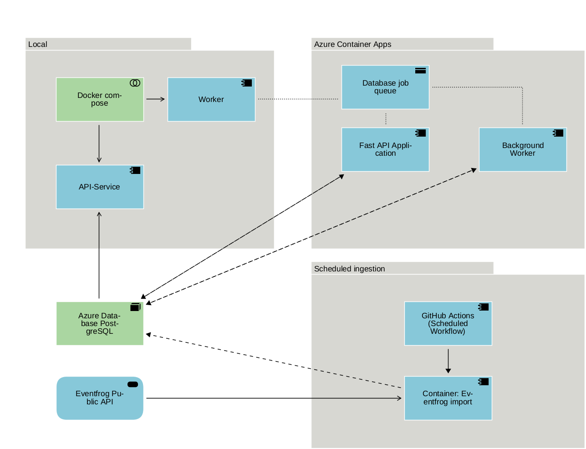
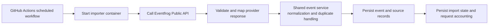

# CultPlanner --- Technical Architecture

> **Personal portfolio documentation** · Architecture snapshot: 17
> November 2026  
> **Project:** SAI1 / CultPlanner --- event discovery and community
> platform

This repository documents the technical architecture and engineering
decisions behind CultPlanner. It is intended as a personal portfolio
reference and as preparation for technical interviews.

**Scope and accuracy:** This README describes the implementation and
project information available at the snapshot date. It distinguishes the
current operational setup from earlier designs and planned architecture.
It contains no credentials, connection strings, personal data or other
secrets.

------------------------------------------------------------------------

## 1. Project overview

CultPlanner is a web application for discovering and managing cultural
events. Its architecture combines:

- a browser-based frontend served by the application;
- a **FastAPI** backend;
- a separate **worker** for background processing;
- external event data ingestion through the **Eventfrog Public API**;
- **Azure Database for PostgreSQL Flexible Server** for persistent data;
- containerized workloads using **Docker** and **Azure Container Apps**.

A central design goal is to keep application logic independent of
environment-specific infrastructure. Database connection details and
credentials are injected through configuration rather than hardcoded
into the application.

## 2. Architecture diagram

The following diagram is the architecture view created in AdoIT using
ArchiMate concepts. It shows the separation between local development,
the Azure-hosted application components and the scheduled Eventfrog
ingestion workflow.



The diagram intentionally keeps the architecture at a high level. It
focuses on the main runtime components, their relationships and the
integration with the external Eventfrog API.

## 3. Main components

| Component | Responsibility |
| :--- | :--- |
| **Browser / frontend** | User interface; static assets are served by the application |
| **FastAPI** | HTTP endpoints, request validation and application services |
| **Worker** | Executes background jobs outside the request-response path |
| **Job queue** | Persists and coordinates background work |
| **Eventfrog adapter** | Retrieves and maps event data from the external provider |
| **GitHub Actions scheduled workflow** | Triggers the scheduled Eventfrog import container |
| **Azure PostgreSQL Flexible Server** | Persistent application data and import state |
| **Alembic** | Versioned database schema migrations |

### Why separate the API and worker?

The API handles synchronous user requests. Background tasks can take
longer, fail transiently or need retries, so they are handled by a
worker instead of holding up a user-facing request. Both components
share the application logic and database schema while having distinct
runtime responsibilities.

## 4. Docker and configuration

Docker provides a consistent runtime for the application components.

The local Compose setup contains:

- `api` --- the FastAPI application;
- `worker` --- background job processing.

Both services receive configuration through environment variables. The
database connection is selected with:

``` text
KULTURPLANER_DATABASE_URL
```

This keeps database hostnames and credentials out of application code
and allows the same application image to be configured for different
environments.

**Environment separation:** local development must use a dedicated
development database. It must never point at production.

## 5. Backend request flow

The backend uses FastAPI with SQLModel / SQLAlchemy.

A typical request follows this path:

1.  The browser sends an HTTP request to the API.
2.  A router validates and dispatches the request.
3.  Service-layer functions apply the business rules.
4.  The database layer reads or writes PostgreSQL records.
5.  The API returns a structured response to the frontend.

The frontend is served as static assets by the application, keeping the
deployment footprint relatively small.

## 6. Background processing

The project uses a worker and a database-backed job queue to move
background work out of the user-facing request path.

The architecture separates:

1.  job creation / enqueueing;
2.  job claiming;
3.  job execution;
4.  retry and failure handling.

The project specification describes PostgreSQL job claiming with
`SELECT ... FOR UPDATE SKIP LOCKED`, together with fencing and retry
handling. This lets competing workers claim queued work safely without
processing the same job concurrently.

## 7. Automated Eventfrog ingestion

### Scheduled workload shown in the architecture

The AdoIT architecture diagram shows **GitHub Actions** as the
scheduler. Its scheduled workflow starts the `eventfrog-import`
container. The container calls the Eventfrog Public API and persists
imported data in Azure Database for PostgreSQL Flexible Server.

The application API and background worker are hosted separately in Azure
Container Apps. he scheduled ingestion is therefore represented as a GitHub Actions 
scheduled workflow, rather than an Azure Container Apps scheduled job.


### Import pipeline



The import process:

1.  The scheduled container starts.
2.  The Eventfrog adapter calls the Eventfrog Public API over HTTPS.
3.  Responses are validated and mapped into the common event input
    model.
4.  The shared event service normalizes records and applies
    duplicate-handling rules.
5.  Event and source records are persisted in PostgreSQL.
6.  Import state and request accounting are persisted so later runs can
    continue safely.

### Operational safeguards

The import service includes the following controls:

- daily delta imports;
- periodic full reconciliation (30-day interval);
- minimum request interval of approximately 2.05 seconds;
- daily request cap of 2,000;
- a time-limited import lease to avoid overlapping runs;
- persistent import state and request accounting.

These controls help respect provider request limits and make scheduled
processing more resilient to restarts and retries.


## 8. Database and schema management

The application uses **Azure Database for PostgreSQL Flexible Server**.

The application reads its connection from:

``` text
KULTURPLANER_DATABASE_URL
```

In Azure:

- the connection URL is provided as a Container Apps secret;
- the connection uses TLS certificate verification (`verify-full`);
- a trusted CA bundle is used for certificate validation;
- database credentials are not embedded in the container image or source
  code.

### Database migrations

Schema changes are managed with **Alembic**:

- migrations are version-controlled;
- schema upgrades are explicit deployment / release steps;
- the API does not silently modify the schema on startup.


## 9. Deployment and security principles

The architecture follows a configuration-driven deployment model:

- container images contain application code, not secrets;
- environment-specific values are injected at runtime;
- sensitive values are held as Azure Container Apps secrets;
- database connectivity is encrypted and certificate-verified;
- database URLs and API credentials are not committed to source control.

The repository's CI/CD design includes automated checks on pushes and
pull requests. The documented target pipeline builds a container image
and deploys through staging, with production promotion gated by
approval.

## 10. Key architecture decisions

| Decision | Reason |
| :--- | :--- |
| **Dockerized services** | Repeatable runtime and fewer environment-specific differences |
| **Separate API and worker** | Long-running tasks do not block user-facing requests |
| **Database-backed job queue** | Persistent job state and coordinated processing |
| **External source adapter** | Isolates provider-specific API behaviour from core event logic |
| **Shared event service** | Reuses normalization and duplicate-handling rules |
| **Persistent import state** | Supports safe continuation across scheduled runs |
| **Request pacing and quota** | Respects external API limits |
| **Import lease** | Prevents overlapping importer executions |
| **Managed PostgreSQL** | Managed relational persistence and database operations |
| **Alembic migrations** | Reviewable and repeatable schema evolution |
| **Runtime secrets** | Same application image can be configured without embedding credentials |

------------------------------------------------------------------------

**Snapshot date:** 17 November 2026  
**Maintainer:** Personal portfolio copy
